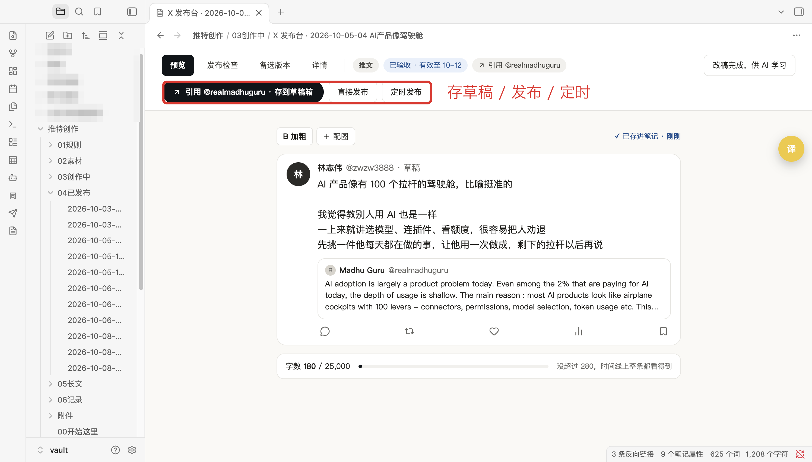
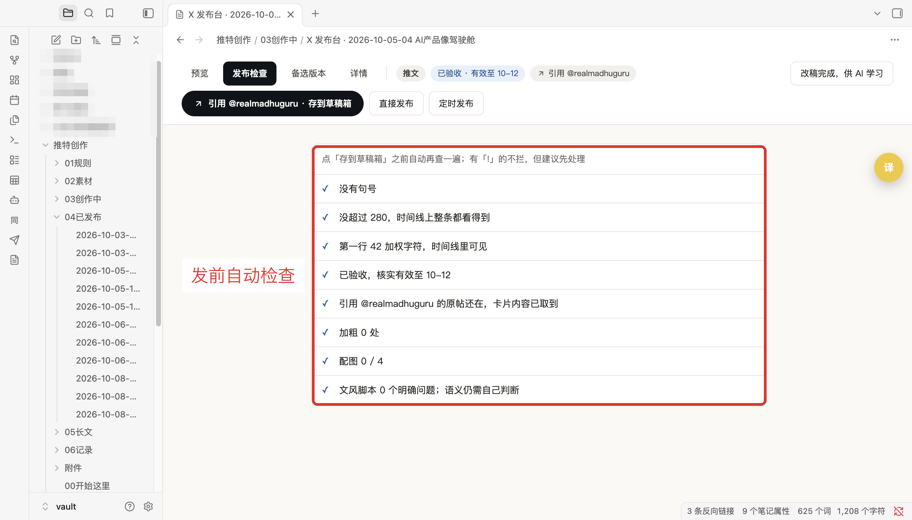
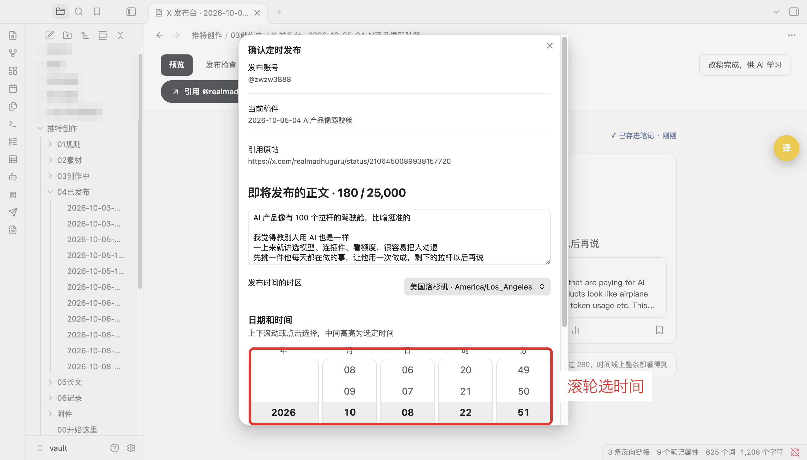
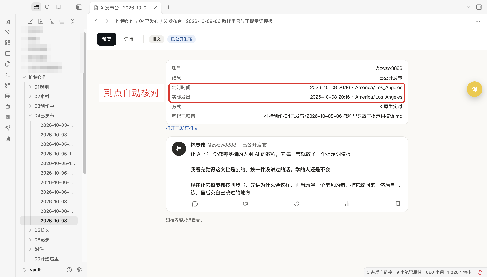
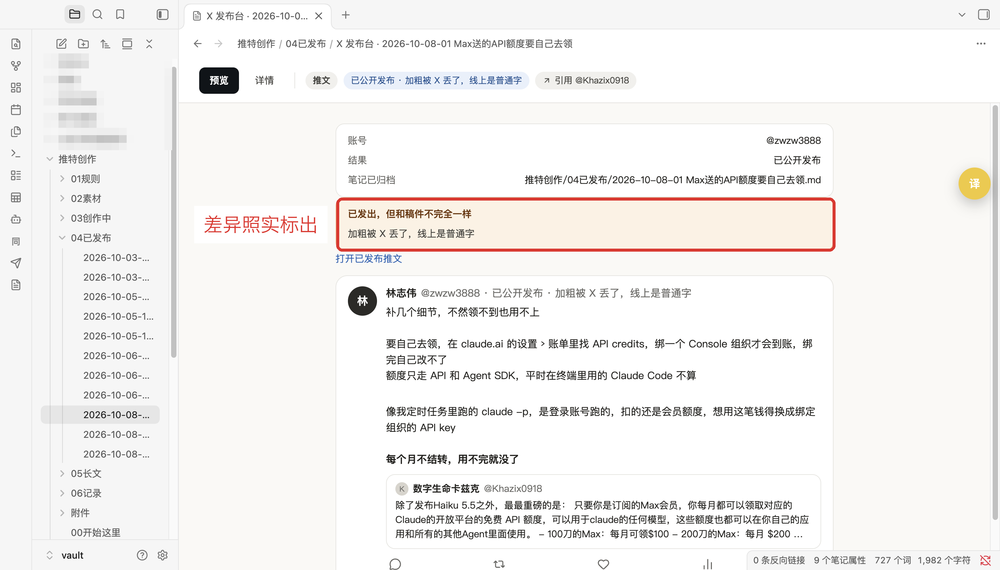

# X 发布台 · X Publish Desk

在 Obsidian 里写 X（Twitter）推文：边写边看发出去的样子，一键存到 X 草稿箱、直接发布或定时发布。发完程序会回到 X 上核对，确认无误后把笔记移到「已发布」文件夹。

> Write X posts in Obsidian with a live preview, then save them as drafts, publish, or schedule them. After every submission the plugin reads the post back from X before calling it done, and moves the note to your "published" folder. The UI is in Chinese.



## ⚠️ 先看风险

这个插件**不走 X 官方 API**。它拿你从浏览器导出的登录 cookie，在本机开一个看不见的浏览器替你点按钮。

- X 的自动化规则不允许用脚本操作网页版。**用这个插件发帖，账号有被限制或封禁的风险，后果自负。**
- X 改了网页，插件可能就失效了，要等更新。
- cookie 等于你的登录状态，**不要放进笔记库、网盘或 git 仓库**。

能接受再往下看。作者自己每天在用，但只在 macOS 上测过。

## 能做什么

| | |
|---|---|
| **所见即所得** | 预览和 X 时间线一样：加粗、引用卡片、配图、280 字折叠线、X 算法的加权字数 |
| **存草稿 / 直接发布 / 定时发布** | 定时用 X 自己的定时功能，电脑关机也会按时发 |
| **发前检查** | 拦截空正文、没配对的 `**`、漏转换的双链、「待补」这类占位字；提醒会被转成短链的网址 |
| **发完核对** | 发布后打开帖子逐字比对正文、作者、引用、配图、加粗，都对上才算成功 |
| **不会重复发** | 网络出错、结果不明的情况，会记下来并禁止重发，让你先去 X 上看 |
| **自动归档** | 核对通过后把笔记移到「已发布」，页面上显示帖子链接和发出时间 |
| **定时稿到点核对** | 到点后自动去你的主页找到那条帖子，把状态从「已排期」改成「已公开发布」 |
| **格式差异照实说** | 比如 X 把加粗丢了，照样归档，但会标出「加粗被 X 丢了」 |









## 不需要任何 AI

插件本身不调用 AI。你用 Claude、ChatGPT、Codex、别的工具，或者自己手写都行，只要稿子是 Obsidian 里的一篇笔记。

想让 AI 助手在聊天里替你发，见下面的「让 AI 助手代发」。

## 安装

需要：macOS（Linux 理论上可以，没测过）、[Node.js](https://nodejs.org) 18+、Python 3.10+。

**1. 装后端**（真正操作 X 的部分，Obsidian 插件商店装不了，要自己下载）

```bash
git clone https://github.com/3052311495a-tech/x-publish-desk.git ~/x-publish-desk
cd ~/x-publish-desk
./setup.sh
```

`setup.sh` 会建一个 Python 环境、装 Playwright 和 Chromium、装 X 官方的字数计算库，并生成 `config.json`。

**2. 装插件**

- 用 [BRAT](https://github.com/TfTHacker/obsidian42-brat)：添加 `3052311495a-tech/x-publish-desk`；或者
- 手动：从 [Releases](https://github.com/3052311495a-tech/x-publish-desk/releases) 下载 `main.js`、`manifest.json`、`styles.css`，放进 `你的笔记库/.obsidian/plugins/x-publish-desk/`，在设置里启用。

**3. 导出 X 的 cookie**

1. 在 Chrome 里登录 X，装 [Cookie-Editor](https://cookie-editor.com) 扩展
2. 在 x.com 页面打开扩展，点 Export → JSON，复制
3. 存成一个文件，放在笔记库外面，比如 `~/.x-publish-desk/cookies.json`，然后 `chmod 600` 这个文件

cookie 过期后插件会提示「登录过期」，重新导出覆盖就行。

**4. 填设置**

Obsidian 设置 → X 发布台：

- **后端文件夹**：第 1 步 clone 的位置
- **X 账号**：比如 `@your_handle`。插件每次都会核对登录的是不是这个号，不是就停下
- **Cookie 文件**：第 3 步的文件路径
- **笔记库绝对路径**、**草稿 / 已发布 / 长文 / 附件文件夹**：默认是 `推特创作/03创作中`、`推特创作/04已发布`、`推特创作/05长文`、`推特创作/附件`，可以改成你自己的

这些设置存在后端文件夹的 `config.json` 里，插件和命令行共用一份。

## 笔记怎么写

在草稿文件夹里新建一篇笔记：

```markdown
---
quote: https://x.com/someone/status/1234567890   # 可选：引用这条帖子
---

## 正文

第一行是开头

**这句会变成 X 的加粗**

![[配图.png]]

## 备注

这里往下写什么都行，不会发出去
```

- 只有 `## 正文` 下面、到下一个标题之前的内容会发出去。笔记里其他地方可以放素材、备注、备选版本
- 正文末尾单独成行的 `![[图片]]` 是配图：最多 4 张图，或 1 个 GIF / 视频
- 用 `**...**` 加粗，不能跨段

在 Obsidian 里点开这篇笔记就会进入发布台。顶上的「发布检查」列出要注意的地方，确认没问题后点「存到草稿箱」「直接发布」或「定时发布」。

**可选的验收字段**：设置里打开「要求验收字段」后，只有 frontmatter 写了 `status: writing`、`delivery_ready: true` 和带时区的 `expires_at` 的笔记才能发。适合由 AI 起草、需要人审一遍才能发的工作流。默认关闭。

## 让 AI 助手代发

`publish.py` 是给命令行和 AI 助手用的入口，和插件按钮共用同一套程序和记录：

```bash
# 1. 预览：什么都不发，输出确认单和一个确认码
~/x-publish-desk/.venv/bin/python ~/x-publish-desk/publish.py preview --note "标题关键词" --action schedule --at "2026-10-10 09:00" --zone Asia/Shanghai

# 2. 人看过确认单之后，带上确认码才会发
~/x-publish-desk/.venv/bin/python ~/x-publish-desk/publish.py send --note "标题关键词" --action schedule --at "2026-10-10 09:00" --zone Asia/Shanghai --confirm 3f9a1c

# 核对到点的定时稿（只读）
~/x-publish-desk/.venv/bin/python ~/x-publish-desk/publish.py follow-up
```

确认码由「这篇笔记的内容 + 发布方式 + 时间」算出来。预览之后改了稿子或时间，确认码就对不上，发不出去。这样可以保证你确认的就是最后发出去的。

[`agent/SKILL.md`](agent/SKILL.md) 是写给 AI 助手的说明，Claude Code、Codex 或其他能跑命令的助手都能用：把里面的 `<BACKEND>` 换成你的后端路径，放进它读取技能或说明的地方即可。说明里要求助手先把确认单给你看，等你明确同意才发送。

## 长文（可选）

插件能预览和编辑 X Articles 长文。把长文上传到 X 草稿要用第三方工具 [x-article-draft-uploader](https://github.com/mcncarl/yichen-skills/tree/x-article-draft-uploader-v1.0.1/yichen-x-article-draft-uploader)，它的许可证不允许再分发，所以本仓库不附带。想用的话自己安装，再把它的 `upload_markdown_to_x_article.py` 路径填进设置里的「长文上传工具」。长文只能存草稿，要你自己到 X 上点发布。

## 已知限制

- 只支持单条推文，不支持串推
- 正文里同时有链接和加粗时，实测 X 可能把加粗丢掉（插件会照实标出）
- 时区选择目前只有北京时间和洛杉矶时间（命令行可以用任何 IANA 时区）
- 只在 macOS + Chrome 导出的 cookie 下测过

## 开发

```bash
npm ci
npm run build
npm test
```

- TypeScript 插件：`main.ts`、`src/`
- Python 后端：`runner.py`（短推草稿）、`delivery_runner.py` 和 `delivery/`（发布、定时、核对）、`upload.py`（X 网页操作）、`checks.py`（发前检查）、`publish.py`（命令行入口）
- 运行记录（回执、证据截图）写在 `state/`，不进 git

## 许可

MIT © 林志伟 ([@zwzw3888](https://x.com/zwzw3888))。第三方代码和依赖的许可见 [THIRD_PARTY_NOTICES.md](THIRD_PARTY_NOTICES.md) 和 `licenses/`。
